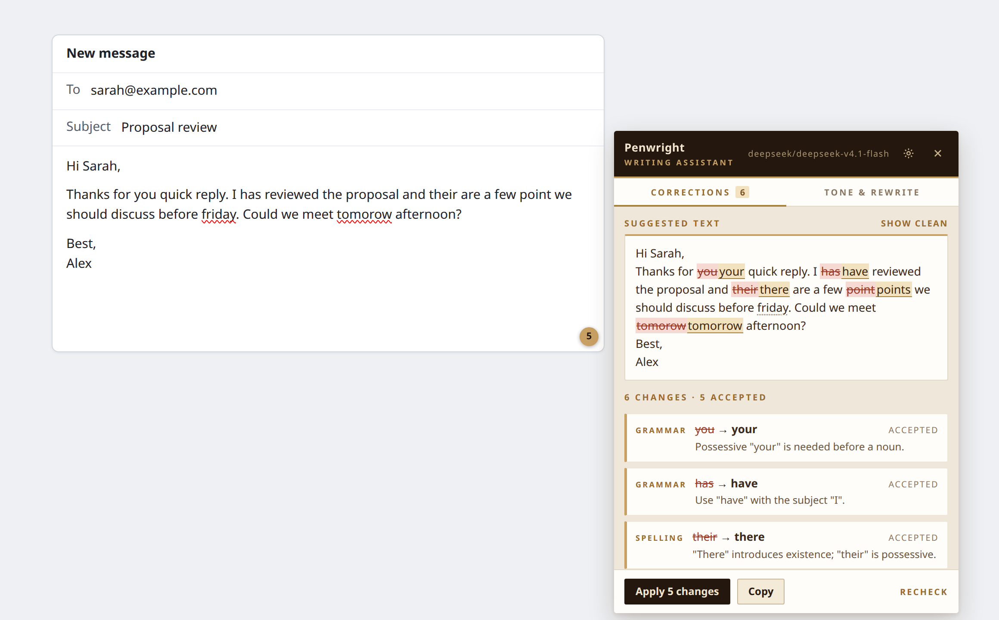
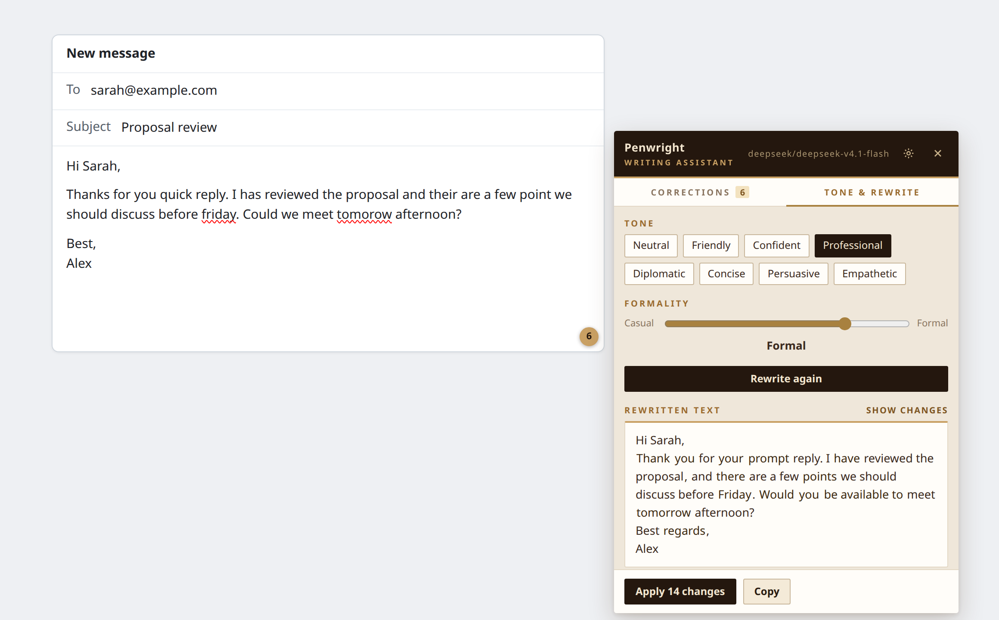
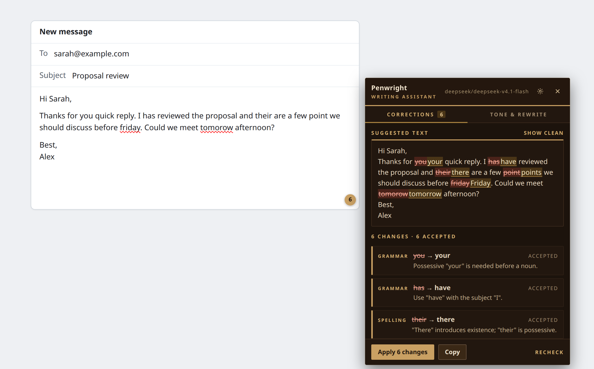
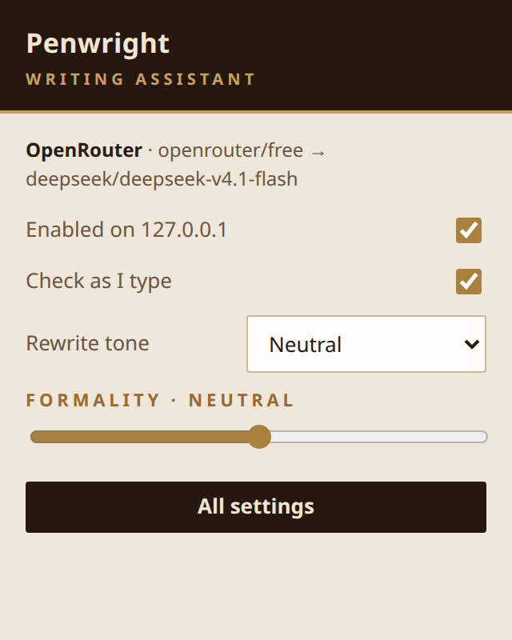

# Penwright

**A lightweight, open-source writing assistant for Chromium browsers, powered by the
LLM you choose.** Type in any text field; Penwright checks your text when you pause,
shows the fixes as a word-level diff, and writes back the ones you keep. A second tab
rewrites the text in the tone and formality you pick.



- **Your model, your key.** OpenRouter, OpenAI, DeepSeek, Ollama, LM Studio, Unsloth
  Studio, or any OpenAI-compatible endpoint. Works with free OpenRouter models out of the
  box, with a cheap fallback when they're unavailable.
- **Fix grammar, spelling, and punctuation** with minimal edits. Click any change to
  skip it; Apply keeps your editor's undo history and formatting.
- **Rewrite in 8 tones** (friendly, confident, professional, diplomatic, concise,
  persuasive, empathetic, neutral) on a 5-step casual ↔ formal scale.
- **Works where you write:** text areas, text inputs, and rich-text (contenteditable)
  editors, including fields inside iframes.
- **Small and private:** Manifest V3, plain JavaScript, no build step, no runtime
  dependencies, under 40 KB zipped. No analytics; text goes only to the endpoint you set.

| Tone & rewrite | Dark mode | Popup |
|---|---|---|
|  |  |  |

## Install

Penwright runs in Chrome, Edge, Brave, Arc, Vivaldi, Opera, and other Chromium browsers
(version 116 or later).

1. Download or clone this repository.
2. Open `chrome://extensions` (or `edge://extensions`) and turn on **Developer mode**.
3. Click **Load unpacked** and select the `src/` folder.
4. The options page opens. Paste your [OpenRouter key](https://openrouter.ai/keys) (or
   pick another provider) and press **Test connection**.

That's it. Start typing in any text field.

## Quick start with each provider

| Provider | What you need |
|---|---|
| OpenRouter (default) | An API key. Default model `openrouter/free`, fallback `deepseek/deepseek-v4.1-flash`. |
| OpenAI | An API key. Default `gpt-6-luna`. |
| DeepSeek | An API key. Default `deepseek-flash`. |
| Ollama | `ollama serve` and a pulled model. No `OLLAMA_ORIGINS` setup needed. |
| LM Studio | Local server started with a model loaded. |
| Unsloth Studio | `unsloth studio` and an `sk-unsloth-…` key. |
| Custom | Any OpenAI-compatible `/v1` URL (vLLM, llama.cpp, LiteLLM, Groq…). |

Details, including OpenRouter's zero-data-retention setting and free-model limits, are
in [docs/providers.md](docs/providers.md).

## Documentation

- [User guide](docs/user-guide.md): badge states, reviewing and applying changes,
  rewriting, settings, troubleshooting
- [Providers](docs/providers.md): setup for each provider, fallback behaviour, choosing
  a model
- [Privacy policy](docs/privacy.md): what is sent where, what is stored, permissions
- [Development](docs/development.md): architecture, tests, screenshots, releasing,
  contributing

## Development

```sh
npm install && npx playwright install chromium
npm test             # unit + end-to-end tests with the real extension (no network)
npm run test:live    # live OpenRouter tests; needs OPENROUTER_API_KEY or .env
npm run zip          # dist/penwright-<version>-{chromium,firefox}.zip
```

See [docs/development.md](docs/development.md).

## License

[MIT](LICENSE) © 2026 Linh Vu
