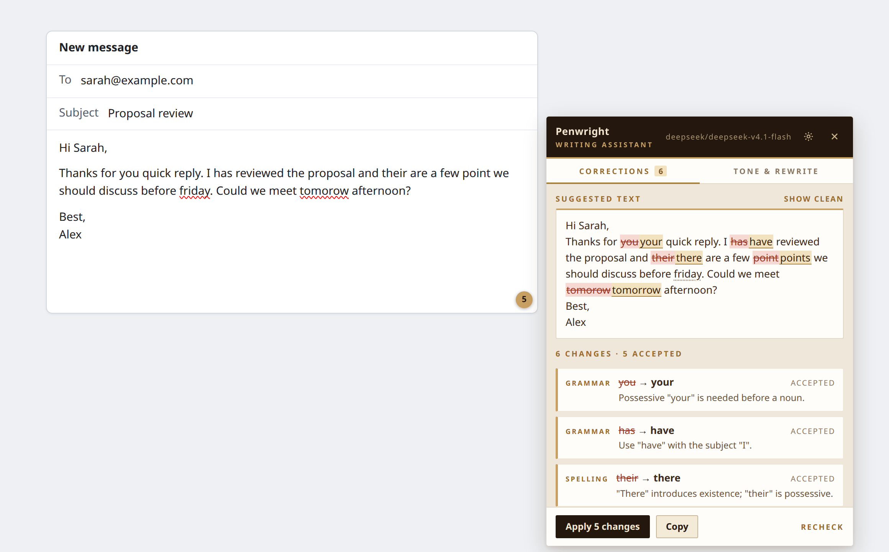
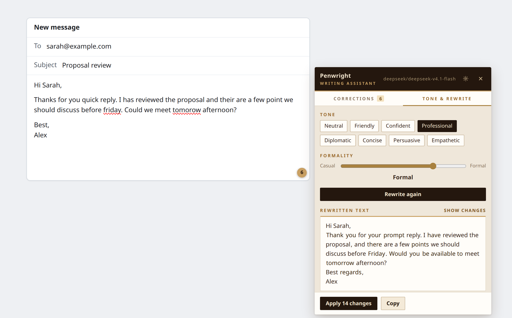
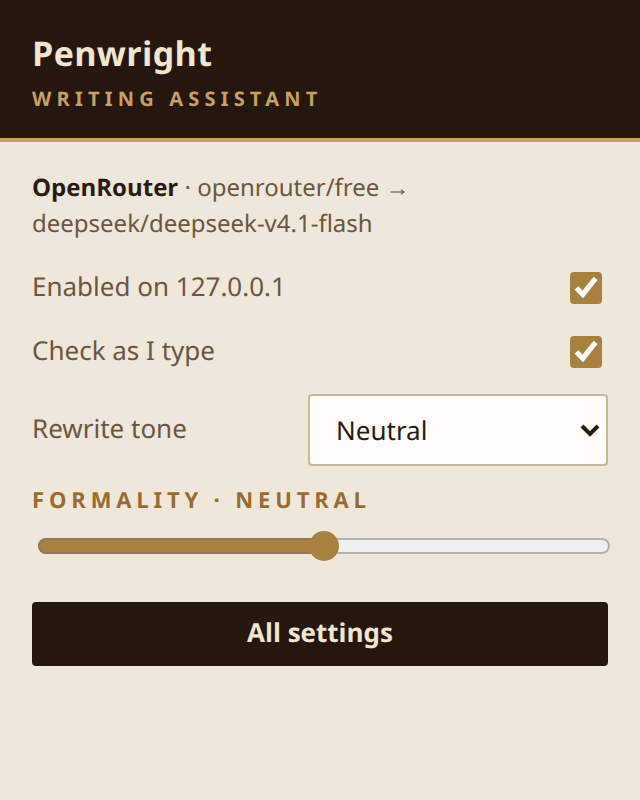
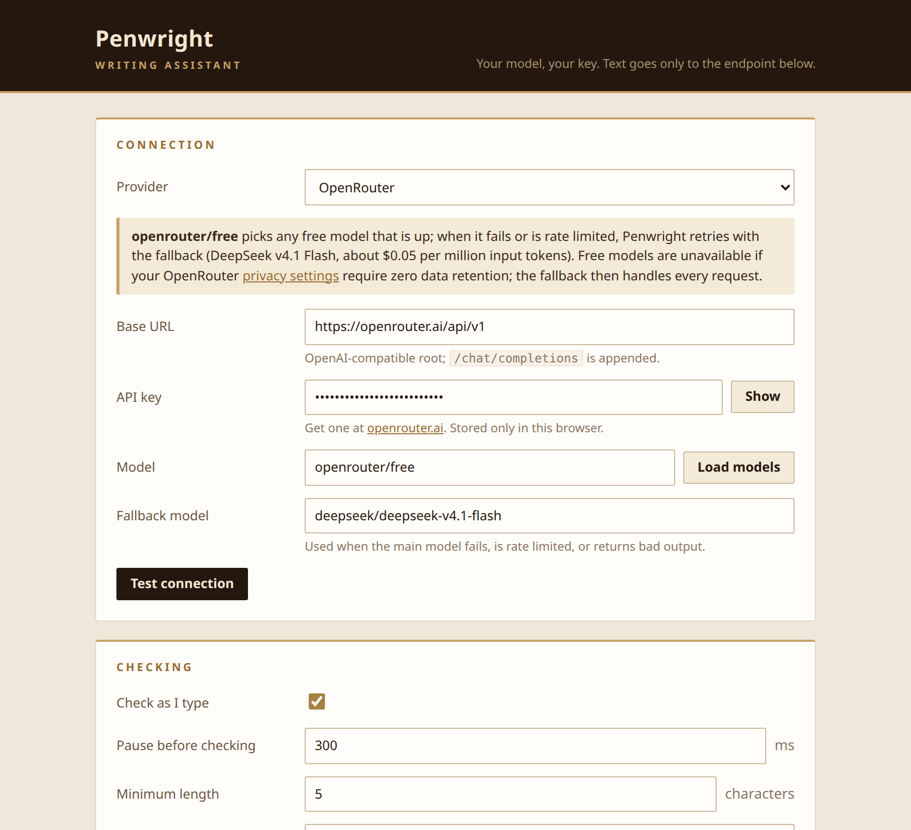
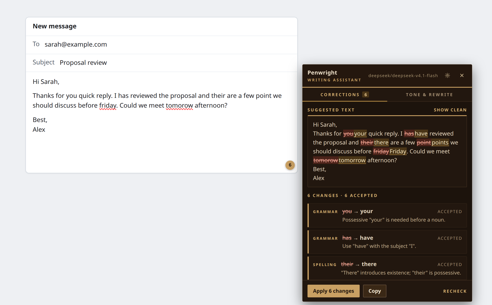
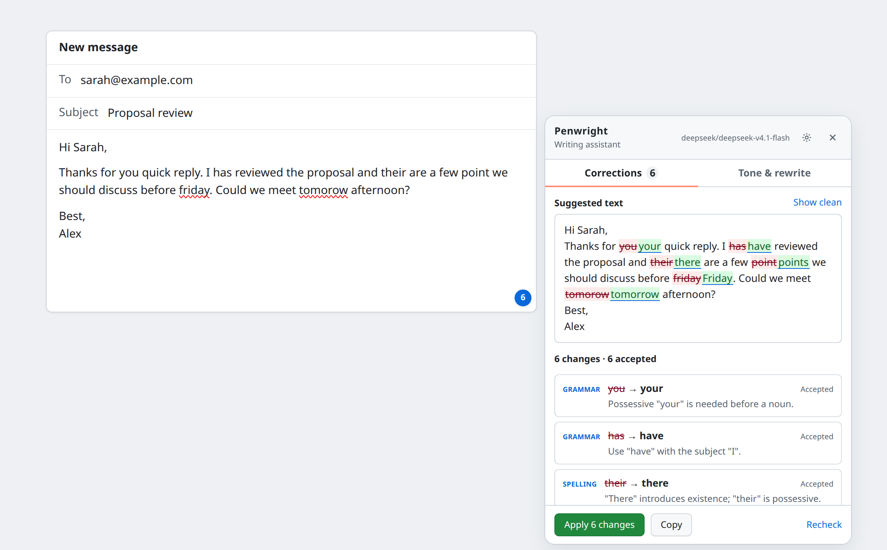

# User guide

## First run

1. Install the extension (see the [README](../README.md#install)). The options page
   opens by itself.
2. Pick a provider, paste your API key (not needed for Ollama or LM Studio), and press
   **Test connection**. A green result shows the model that answered, how long it took,
   and its fix for a sample sentence.

## Corrections

Focus any text area, text input, or rich-text editor. A small square badge appears in
the bottom-right corner of the field.

| Badge | Meaning |
|---|---|
| pen | Waiting. Penwright checks when you pause typing. |
| spinning ring | Checking. |
| number (gold) | Suggestions found. Click to review. |
| check mark | No corrections suggested. |
| `!` | Something went wrong. Hover for the error, or click to see it in the panel. |

Click the badge to open the panel.

- **Suggested text** shows the whole text with each change marked: struck-out red is
  removed, gold is added.
- **Click a change** (in the text or its card) to skip it. A skipped change gets a
  dotted underline; click again to bring it back.
- **Show clean** hides the struck-out words so you can read the result.
- **Apply** writes the accepted changes into the field. Each change goes in through the
  editor's own input path, so **Ctrl+Z** undoes it and bold, links, and other formatting
  around it stay as they were.
- **Copy** copies the corrected text instead.
- **Recheck** asks the model again, for example after you edit the text by hand.

If you keep typing after a check, the suggestions are refreshed when you pause again.
If the text changed while the panel was open, Apply rechecks first instead of writing
stale edits.

Some editors reject programmatic input. In that case Penwright copies the corrected text
to your clipboard and tells you to paste it.

## Tone & rewrite

1. Open the panel and choose **Tone & rewrite**.
2. Pick a tone: Neutral, Friendly, Confident, Professional, Diplomatic, Concise,
   Persuasive, or Empathetic.
3. Set formality from *Very casual* to *Very formal*.
4. Press **Rewrite**. The rewrite also fixes spelling and grammar.
5. Review the changes the same way as corrections, then **Apply** or **Copy**.

The tone and formality you pick become your defaults (also editable in the popup and
the options page).

## Popup

The toolbar button shows the active provider and model, and lets you:

- turn Penwright off (or back on) for the current site,
- turn check-as-you-type on or off (with it off, click the badge to check),
- set the default rewrite tone and formality,
- open all settings.

## Options

| Setting | Default | Notes |
|---|---|---|
| Provider, base URL, API key, model | OpenRouter | See [providers](providers.md). Each provider remembers its own values. |
| Fallback model | `deepseek/deepseek-v4.1-flash` on OpenRouter | Used when the main model fails. |
| Check as I type | on | |
| Pause before checking | 1200 ms | How long after the last keystroke. |
| Minimum length | 12 characters | Shorter text is not sent automatically. |
| English variant | same as the text | American, British, Australian, or Canadian spelling. |
| Default tone / formality | Neutral / Neutral | |
| Theme | Priority | Priority (espresso and gold, follows dark mode) or GitHub light. |
| Disabled on | none | One hostname per line. |

Text longer than 8,000 characters is not checked.

## Fields Penwright ignores

- passwords and other non-text inputs (email, number, date…)
- read-only and disabled fields
- code editors: Monaco (VS Code web), CodeMirror, Ace
- contenteditable regions with `spellcheck="false"`
- anything inside an element with `data-gramm="false"` or `data-penwright="off"`
  (site authors can use these to opt out)

## Themes and dark mode

The default Priority theme follows the system colour scheme. **Options → Appearance →
Theme** switches to GitHub light, which stays light in dark mode.

| Priority, dark | GitHub light |
|---|---|
|  |  |

## Troubleshooting

| Symptom | Fix |
|---|---|
| Badge shows `!` with "Add your API key" | Open options, paste the key, press Test connection. |
| `ZDR violation` / `0 endpoints … guardrail restrictions` (OpenRouter) | Your privacy settings exclude free models. Keep a fallback model set, or allow free providers in OpenRouter's privacy settings. See [providers](providers.md#openrouter). |
| `429` errors | Rate limited. Set a fallback model, or raise the pause before checking. |
| "Cannot reach http://localhost…" | The local server isn't running, or the base URL/port is wrong. |
| "Penwright was updated. Reload this page." | The extension was reloaded; refresh the tab. |
| No badge on a site | Check the popup (the site may be disabled) and the ignored-field list above. Pages like `chrome://` and the Chrome Web Store don't allow extensions. |
| Badge appears but Apply does nothing | The editor rejects programmatic edits; the text is on your clipboard, paste it. |
